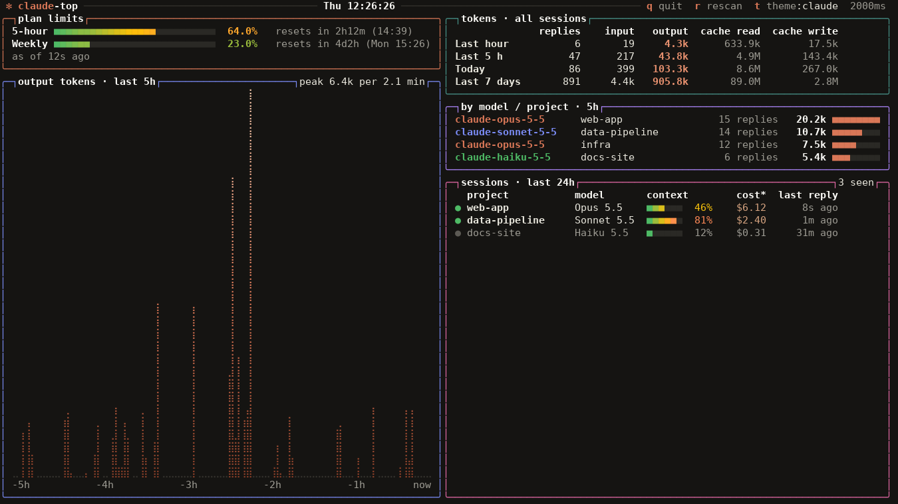
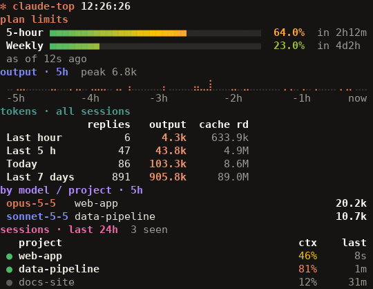
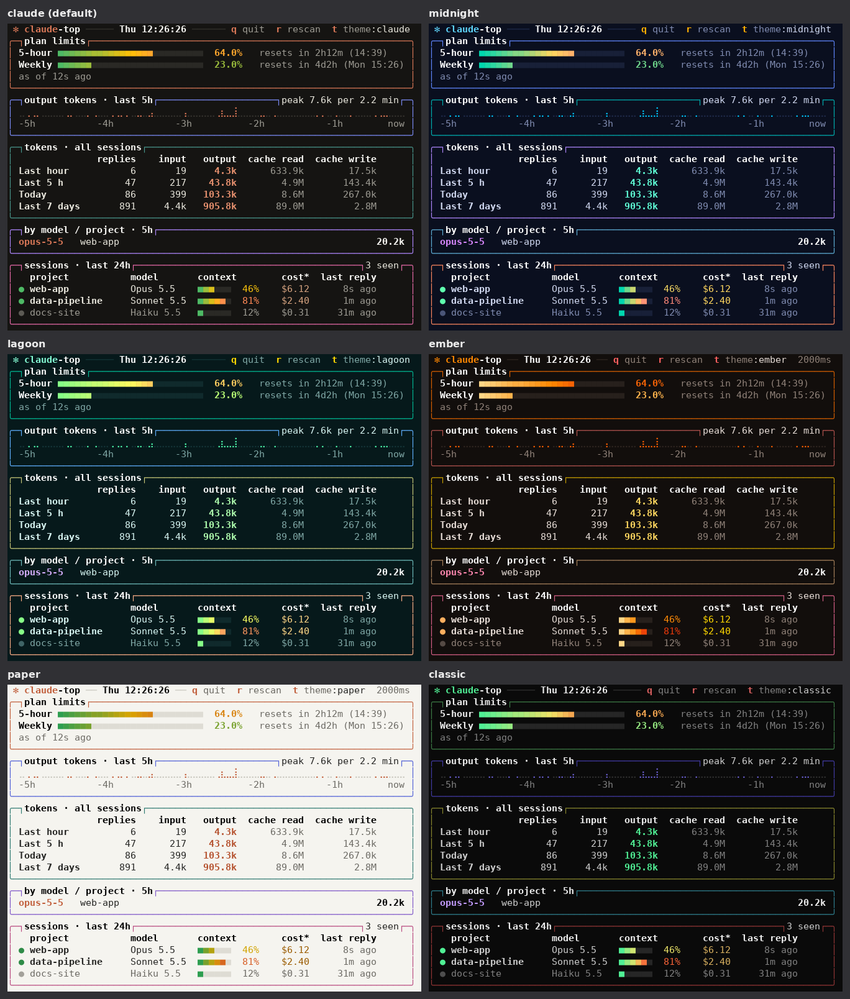

# claude-top

A live terminal view of your Claude Code usage, in the spirit of `nvtop` / `htop`.
It shows how much of your plan's 5-hour and weekly limits you've used, when they
reset, token activity across all sessions, and which sessions are running. It also
adds a one-line usage summary to the bottom of every Claude Code session.



In a narrow pane it switches to a compact view:



*(Screenshots use made-up data.)*

And at the bottom of each Claude Code session:

```
Opus 5.5 │ 5h 42% (resets 14:00) │ week 18% │ ctx 31%
```

It has boxed panels with colored borders, color-graded meters and a dotted activity
graph, with **six color themes** you can switch by pressing **`t`** (see
[Color themes](#color-themes)). The layout adapts to the window size, from a small side
pane to a full-screen two-column view (see [Window size](#window-size)).

---

## Contents

- [System requirements](#system-requirements)
- [Installation](#installation)
- [Usage](#usage)
- [Window size](#window-size)
- [Color themes](#color-themes)
- [How it works](#how-it-works)
- [Update frequency](#update-frequency)
- [Plans and limits](#plans-and-limits)
- [Configuration](#configuration)
- [Updating](#updating)
- [Uninstalling](#uninstalling)
- [Troubleshooting](#troubleshooting)
- [Privacy](#privacy)
- [Repository layout](#repository-layout)

---

## System requirements

| Requirement | Details |
|---|---|
| **Operating system** | Linux or macOS. On Windows, use WSL. Native Windows Python has no `curses` module, so `claude-top` won't run there. |
| **Python** | 3.8 or newer, with the standard `curses` module (included with Python on Linux and macOS). **No pip packages needed.** Only the standard library is used. |
| **Claude Code** | The Claude Code CLI, installed and signed in. Any recent version with status line support. |
| **Plan** | **Plan-limit bars (5-hour / weekly):** a claude.ai **Pro, Max or Ultra** subscription. Claude Code only shares those numbers for these plans. On API-key or other plans, everything else (token totals, activity graph, sessions, cost estimate) still works, and the plan section stays empty. See [Plans and limits](#plans-and-limits). |
| **Terminal** | Any terminal with UTF-8 and 256 colors (GNOME Terminal, iTerm2, Windows Terminal + WSL, Konsole, kitty, Alacritty, tmux, etc.). 8-color terminals work with simpler colors. The font needs box-drawing and braille characters; the default fonts on Linux and macOS have them (if `btop` looks right, `claude-top` will too). Any size from 24 × 3 up; about 80 × 30 shows every section, and 140+ columns gives a two-column view. |
| **Shell tools (installer only)** | `bash`, `install`, `tail`. These are standard on Linux and macOS. |

Check your setup:

```bash
python3 --version                     # 3.8 or newer
python3 -c "import curses; print('curses ok')"
claude --version                      # Claude Code is installed
```

---

## Installation

### Quick install

```bash
git clone https://github.com/deanzadok/claude-top.git
cd claude-top
./install.sh
```

Then **open a new terminal** and run:

```bash
claude-top
```

The plan-limit bars appear after Claude's next reply in any Claude Code session.
Claude Code picks up the settings change by itself. If the status line doesn't show
up in an already-open session, restart that session.

### What the installer does

1. **Picks a Python.** It uses `/usr/bin/python3` if present, otherwise `python3` on
   your PATH. It checks for version 3.8+ and `curses`. Using the system Python means
   switching conda or virtual environments can't break the tool.
2. **Copies `src/claude-top` to `~/.local/bin/claude-top`.** It points the script's
   first line at the chosen Python.
3. **Copies `src/statusline.py` to `~/.claude/usage-monitor/statusline.py`.**
4. **Adds a `statusLine` entry to `~/.claude/settings.json`**, after saving a timestamped
   backup next to it (`settings.json.bak-YYYYMMDD-HHMMSS`). The entry looks like:

   ```json
   "statusLine": {
     "type": "command",
     "command": "/usr/bin/python3 -I /home/you/.claude/usage-monitor/statusline.py",
     "padding": 0
   }
   ```

   **If you already have a different status line, the installer leaves it alone** and
   tells you. Rerun with `--force` to replace it. `claude-top` needs this status line to
   show plan limits; see [How it works](#how-it-works).
5. **Warns you if `~/.local/bin` isn't on your PATH** and prints the line to add.

Running the installer again is safe: it updates the files and keeps your settings.

### Installer options

| Option / variable | Effect |
|---|---|
| `--force` | Replace an existing status line that belongs to another tool. |
| `--no-statusline` | Copy the files but don't touch `settings.json` (see [manual setup](#manual-installation)). |
| `PYTHON=/path/to/python3` | Use a specific Python interpreter. |
| `BIN_DIR=~/bin` | Install the `claude-top` command somewhere other than `~/.local/bin`. |
| `CLAUDE_CONFIG_DIR=/path` | Use a Claude Code config folder other than `~/.claude`. Claude Code supports this variable too, so set it the same way for both. |

Example: `PYTHON=/opt/homebrew/bin/python3 BIN_DIR=~/bin ./install.sh`

### Adding `~/.local/bin` to PATH

Most Linux distributions already include it. If `claude-top` says *command not found*:

```bash
# bash
echo 'export PATH="$HOME/.local/bin:$PATH"' >> ~/.bashrc && source ~/.bashrc
# zsh (macOS default)
echo 'export PATH="$HOME/.local/bin:$PATH"' >> ~/.zshrc && source ~/.zshrc
```

### macOS notes

- `/usr/bin/python3` on macOS is Apple's Python, provided by the Xcode Command Line
  Tools. If it asks to install the tools, accept, or point the installer at another
  Python: `PYTHON=$(brew --prefix)/bin/python3 ./install.sh`.
- macOS zsh doesn't include `~/.local/bin` in PATH by default. See above.

### Manual installation

If you prefer not to run the script:

```bash
mkdir -p ~/.local/bin ~/.claude/usage-monitor
cp src/claude-top ~/.local/bin/claude-top
cp src/statusline.py ~/.claude/usage-monitor/statusline.py
chmod +x ~/.local/bin/claude-top ~/.claude/usage-monitor/statusline.py
```

Then add this to `~/.claude/settings.json` (inside the top-level `{ }`), using your
real home path:

```json
"statusLine": {
  "type": "command",
  "command": "python3 -I /home/you/.claude/usage-monitor/statusline.py",
  "padding": 0
}
```

### Keeping your own status line

Claude Code allows only one status line command. If you already have one and want
both, call `statusline.py` from your own script and pass along the same input. It saves
the usage data and prints its own line, which you can use or ignore:

```bash
#!/usr/bin/env bash
input=$(cat)
echo "$input" | python3 -I ~/.claude/usage-monitor/statusline.py > /dev/null   # feeds claude-top
echo "$input" | your-existing-statusline-command
```

---

## Usage

```bash
claude-top            # live, full-screen view (q/Esc quit, r rescan logs, t/T next/previous theme)
claude-top --once     # print one plain-text snapshot and exit (handy for scripts / SSH)
claude-top --once --size 60x20   # snapshot as it would look in a 60x20 window
claude-top --theme paper          # start with a theme (remembered for next time)
claude-top --themes               # list the themes
claude-top --transparent         # use your terminal's own background instead of the theme's
claude-top --once --color        # keep colors when piping a snapshot (--no-color to drop them)
claude-top --help
```

Run it in its own terminal window, tmux pane, or split next to your Claude Code
session.

### What each section means

| Section | Meaning |
|---|---|
| **Plan limits** | Percentage of your 5-hour and weekly (7-day) allowance used, with time until each resets. "As of" says how old the numbers are (see [Update frequency](#update-frequency)). A **Spend** row appears only if your organization set a spend limit. |
| **Output tokens, last 5 hours** | Bar graph of tokens Claude wrote, across all sessions. Each column is a few minutes, depending on terminal width. |
| **Tokens** | Totals for the last hour, last 5 h, today (since local midnight) and last 7 days. *replies* = number of Claude responses (including subagents). *cache read / write* = prompt caching, which is most of the input volume in long sessions. |
| **By model / project** | Where the last 5 hours of output went. |
| **Sessions** | Sessions that replied in the last 24 h: project folder, model, how full the conversation is (*context*), and an estimated cost. Sessions idle for more than 10 minutes are dimmed. |

**About cost:** the cost column is Claude Code's estimate at API list prices. On a
Pro/Max/Ultra subscription you aren't billed this amount. The plan-limit bars are what
count.

---

## Color themes

### Changing the theme

| To… | Do this |
|---|---|
| Switch while it's running | Press **`t`** for the next theme, **`T`** for the previous one. The current theme's name is shown at the top right. |
| Start with a specific theme | `claude-top --theme midnight` |
| See the theme names | `claude-top --themes` |
| Go back to the default | `claude-top --theme claude`, or delete `~/.claude/usage-monitor/prefs.json` |
| Keep your terminal's own background | `claude-top --transparent` (works with any theme) |

**Your choice is remembered.** Switching with `t` or `--theme` saves the theme in
`~/.claude/usage-monitor/prefs.json`, so the next `claude-top` starts with it.
(`--once` snapshots don't change the saved choice.) Each person's choice is stored on
their own machine; nothing in the repo changes.

`--transparent` isn't remembered. To always use it, add an alias to `~/.bashrc` or
`~/.zshrc`: `alias claude-top='claude-top --transparent'`.

### Available themes

| Theme | Look |
|---|---|
| `claude` *(default)* | Claude Code's colors: near-black warm background, cream text, Claude orange accents, Claude Code's green/amber/red for meters, clay→orange→peach graph |
| `midnight` | Deep navy background; teal→gold→pink meters, blue→cyan graph |
| `lagoon` | Very dark teal background; green→yellow→red meters, green graph |
| `ember` | Near-black background with warm orange and red colors |
| `paper` | Light warm background, for light-themed terminals |
| `classic` | Black background with green→yellow→red meters, similar to `btop` |



**Exact colors.** Most modern terminals (GNOME Terminal, iTerm2, kitty, Konsole,
Windows Terminal, xterm) let a program set exact colors. `claude-top` uses this to
show each theme's real colors, and puts your terminal's own palette back when it
exits, including on Ctrl-C or when it is stopped. Other terminals (and tmux) get
the nearest of their 256 standard colors, which is slightly less dark. To always
use the standard colors, set `CLAUDE_TOP_NO_EXACT_COLORS=1`. If `claude-top` is ever
force-killed (`kill -9`) and your terminal colors look off afterwards, run `reset`.

### Making your own theme

Themes live in the `THEMES` list near the top of `src/claude-top`.

1. **Edit the copy in your clone of this repo**, `src/claude-top`, not the installed
   `~/.local/bin/claude-top`. The installer copies `src/claude-top` over the installed
   one, so changes made there are lost on the next update.
2. **Copy an existing entry** (for example the whole `"midnight": { ... },` block),
   paste it below the others, and give it a new name:

   ```python
   "forest": {     # my theme
       "bg": "#0c140e", "text": "#d8e8d8", "dim": "#7f9a85", "faint": "#1f3324", "title": "#ffffff",
       "accent": "#7bd88f", "hotkey": "#ffb454", "empty": "#18261b", "cost": "#e6c07b",
       "live": "#7bd88f", "idle": "#4a5e4f", "out": "#a6e3a1", "bar": "#7bd88f",
       "box_plan": "#4f9d69", "box_graph": "#6a9fb5", "box_tokens": "#b5a642",
       "box_models": "#8f7fc0", "box_sessions": "#c0705a",
       "meter": ("#7bd88f", "#e6c07b", "#e06c75"),
       "graph": ("#1f6b3a", "#7bd88f", "#e0ffe6"),
       "models": {"opus": "#c0a0ff", "sonnet": "#80c8ff", "haiku": "#a6e3a1", "fable": "#ffb454"},
   },
   ```
3. **Change the colors.** Colors are hex codes (`"#rrggbb"`). Every key must be present:

   | Key | Used for |
   |---|---|
   | `bg` | Background |
   | `text` / `dim` / `faint` | Normal text / secondary text (labels, times) / very subtle details (graph baseline, header line, footnote) |
   | `title` | Panel titles and table headers |
   | `accent` | The "✻ claude" title in the header |
   | `hotkey` | The `q`, `r`, `t` key letters in the header |
   | `empty` | Unfilled part of meters |
   | `cost` / `out` / `bar` | Session cost / output token numbers / bars in the model panel |
   | `live` / `idle` | Dot next to active sessions / idle sessions |
   | `box_plan`, `box_graph`, `box_tokens`, `box_models`, `box_sessions` | Border color of each panel |
   | `meter` | Three colors for meters, from empty to full (low → medium → high) |
   | `graph` | Three colors for the activity graph, from bottom to top |
   | `models` | Color per model family; models not listed use `text` |

4. **Preview it** without opening the full screen (this doesn't change your saved theme):
   `src/claude-top --theme forest --once --size 100x30`
5. **Install it** with `./install.sh`. The new theme joins the `t` rotation. To make
   it the default for people who haven't picked a theme yet, move it to the top of
   `THEMES`.

To share a theme with the team, commit the change to `src/claude-top`.

---

## Window size

`claude-top` redraws as soon as the window is resized and picks the best layout for
the space, like `btop`:

| Window | What changes |
|---|---|
| **140+ columns** | Two columns: plan limits and activity graph on the left, tables and sessions on the right. The last box in each column stretches to the bottom. |
| **About 70–139 columns** | One column of boxes with every table column shown. |
| **About 42–69 columns** | Tables keep the key columns (replies, output, cache read); sessions show project, context and time only; reset times shorten to "in 2h13m"; model names drop the `claude-` prefix. |
| **24–41 columns** | Short labels (`5h`, `wk`, `1h`, `7d`) and only replies and output in the token table. |
| **Short windows** | Box borders are removed first (a compact view with colored section titles) if that lets more sections fit. After that, whole sections are dropped, least important first: model breakdown, then sessions, then token totals, then the graph. Plan limits are always kept. |
| **Tall windows** | Spare rows go to more sessions, more model rows, and then a taller activity graph. |
| **Below 24 × 3** | Shows "too small". |

Tip: run it in a narrow side pane (for example 45 × 15) next to Claude Code to see
just the plan bars, the graph and the token totals.

---

## How it works

```
 ┌──────────────── Claude Code (every session) ───────────────┐
 │ after each reply, runs the status line command and passes  │
 │ JSON on stdin: model, context %, cost, and rate_limits     │
 │ (5-hour / weekly % used + reset times)                     │
 └───────────────┬─────────────────────────────┬──────────────┘
                 │                             │ writes conversation logs
                 ▼                             ▼
   ~/.claude/usage-monitor/statusline.py   ~/.claude/projects/**/*.jsonl
     • prints the one-line summary            (token counts for every reply)
     • saves state/rate_limits.json                │
     • saves state/sessions/<id>.json              │
                 │                                 │
                 └──────────────┬──────────────────┘
                                ▼
                     claude-top (reads both, redraws every 2 s)
```

- **Plan limits come only from the status line.** Claude Code doesn't publish them
  anywhere else on disk, and `claude-top` doesn't call any API. So the status line
  script must be installed for the bars to appear.
- **Token counts come from Claude Code's own logs** in `~/.claude/projects/`. Each reply
  is logged with its token usage. `claude-top` reads new lines incrementally and counts
  each reply once, since replies can appear several times in a log. Only logs changed
  in the last 7 days are read.
- **Sessions** come from the per-session files the status line saves. Files older than
  7 days are deleted automatically.

---

## Update frequency

| What | How often |
|---|---|
| Screen, clock, reset countdowns | every 2 seconds |
| Token totals, activity graph, model/project breakdown | every 5 seconds (new replies from any session) |
| 5-hour / weekly percentages | whenever Claude replies in **any** session |
| Sessions list | after each reply in that session |

When no session is active, the plan bars keep their last value and show "as of …
ago". When a window resets, the bar says so until the next reply brings a fresh figure.

**Why the plan bars can't refresh on a timer (for example every 60 seconds):** Claude
Code only hands out the plan percentages together with Claude's replies. There is no
documented way to ask for them in between, and `claude-top` doesn't call any API.
(Claude Code's status line `refreshInterval` setting only re-runs the script with the
same cached numbers, so it wouldn't help.)

**An old figure is usually still right.** Your usage only goes up when Claude does
work, so if no session has replied for a while, your usage hasn't moved either. The
exception is using Claude somewhere this computer can't see: claude.ai in the browser,
the phone or desktop app, or Claude Code on another machine. That usage counts toward
the same limits and appears here after the next reply on this computer.

---

## Plans and limits

| Plan | Plan-limit bars | Everything else |
|---|---|---|
| **Pro** (the $20 plan) | Yes | Yes |
| **Max** (the $100 and $200 plans) | Yes | Yes |
| **Ultra** | Yes | Yes |
| **Team / Enterprise** | Not confirmed. Claude Code's docs only name Pro, Max and Ultra. If the plan section still says "No plan data yet" after a reply, your plan doesn't provide it. | Yes |
| **API key** (pay per use) | No | Yes |

- **The bars are relative to your own plan.** 40% means 40% of *your* plan's
  allowance, so the same tool works on every tier without any setup.
- **Limits cover all models together.** Claude Code reports one 5-hour and one weekly
  figure; it doesn't report per-model limits (for example a separate Fable or Opus
  allowance). If your plan has one, check it with `/usage` inside Claude Code. Your
  use of each model is still shown in the *by model / project* panel, from your
  local logs.
- **Spend limits.** If your organization uses a Claude apps gateway with a spend
  cap, a third **Spend** bar appears with dollars used.

---

## Configuration

Edit the constants near the top of `src/claude-top` in your clone of this repo, then
run `./install.sh`. (You can edit the installed `~/.local/bin/claude-top` directly
for a quick test, but the next install overwrites it.)

| Constant | Default | Meaning |
|---|---|---|
| `REFRESH_S` | `2` | Seconds between screen redraws |
| `SCAN_S` | `5` | Seconds between log scans |
| `KEEP_S` | `7 * 86400` | How far back to read logs / keep session files |
| `GRAPH_MAX_ROWS` | `80` | Tallest the activity graph gets when there's spare height |
| `MAX_SESSIONS` / `MAX_GROUPS` | `8` / `6` | Most rows in the sessions list / model breakdown |
| `TWO_COLUMN_MIN` | `140` | Window width at which the two-column view starts |
| `THEMES` | 6 themes | Colors for each theme. See [Making your own theme](#making-your-own-theme). |

---

## Updating

```bash
cd claude-top
git pull
./install.sh
```

---

## Uninstalling

```bash
./uninstall.sh
```

This removes `~/.local/bin/claude-top` and `~/.claude/usage-monitor/` (scripts and
saved data). It also removes the `statusLine` entry from `settings.json`, but only if
that entry points at this tool, and it backs up the settings first. It never touches
Claude Code's own logs.

---

## Troubleshooting

**"No plan data yet"**
- Wait for Claude to reply once in any Claude Code session. The data arrives with replies.
- Check the status line is set: `grep -A3 statusLine ~/.claude/settings.json`.
- Plan limits are only provided for claude.ai Pro, Max and Ultra plans. API-key sign-ins
  won't show them. See [Plans and limits](#plans-and-limits).
- Check the script runs: `echo '{}' | python3 ~/.claude/usage-monitor/statusline.py`
  should print `?` or a short line, with no error.

**The status line doesn't appear in Claude Code**
- Restart the Claude Code session.
- Run the `command` from `settings.json` by hand with `echo '{}' |` in front to see any error.
- Check that `settings.json` is valid JSON: `python3 -m json.tool ~/.claude/settings.json`.

**`claude-top: command not found`**
- `~/.local/bin` isn't on your PATH. See [Adding `~/.local/bin` to PATH](#adding-localbin-to-path).

**A section is missing**
- The window is too short for it. Sections are dropped least-important first; see
  [Window size](#window-size). Make the window taller, or check with
  `claude-top --once --size 100x50`.

**Strange characters or empty boxes instead of bars and graph dots**
- Your terminal or locale isn't UTF-8. Try `export LANG=en_US.UTF-8` (or `C.UTF-8`).
- Your terminal font lacks braille characters (used for the graph). Switch to a font
  like DejaVu Sans Mono, Ubuntu Mono or any Nerd Font.

**Colors look wrong or washed out**
- Check `tput colors` prints `256`. If not, set `TERM=xterm-256color` (or
  `tmux-256color` inside tmux).
- Prefer your own terminal background? Run `claude-top --transparent`.
- On a light-colored terminal, press `t` until you reach the `paper` theme.

**`ModuleNotFoundError: No module named '_curses'`**
- You're on native Windows, or using a Python built without curses. Use WSL, or install
  with a different Python (`PYTHON=... ./install.sh`).

**The installer said it didn't change settings**
- You already have a different status line. See [Keeping your own status line](#keeping-your-own-status-line),
  or rerun with `./install.sh --force` to replace it.

**Restoring settings from a backup**
```bash
ls ~/.claude/settings.json.bak-*
cp ~/.claude/settings.json.bak-YYYYMMDD-HHMMSS ~/.claude/settings.json
```

---

## Privacy

Everything stays on your machine. `claude-top` makes **no network requests**. It reads
Claude Code's local logs (token counts, model, time and folder only, never message
text) and the small JSON files saved by the status line script. Nothing is uploaded or
shared.

---

## Repository layout

```
claude-top/
├── README.md          this file
├── LICENSE            MIT license
├── install.sh         installer (safe to rerun)
├── uninstall.sh       removes everything the installer added
├── docs/              screenshots and theme previews for this README (made-up data)
└── src/
    ├── claude-top     the live monitor (Python, standard library only)
    └── statusline.py  Claude Code status line script; saves data for claude-top
```

---

## License

MIT. See [LICENSE](LICENSE).
